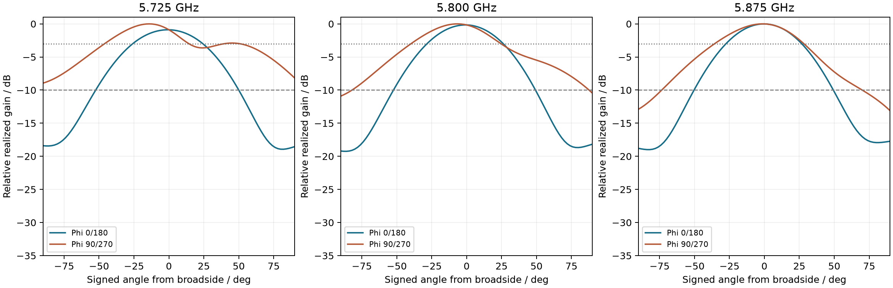

# Project3 最新模型核验报告

对象为 R3：5.8 GHz、1×2 微带贴片阵列，含 Würth 60312202114509 SMA 外接口。依据为课件第 12、16 页及 [目标与要求](Project3_目标与要求.md)。本报告依据保存的 2026-10-23 求解与核验数据；工程目录为 [R3 交付](../output/Project3_fabrication_R3/README_制造状态.md)。

## 当前结论

制造资料齐备，中心 5.8 GHz 工作点和 5.725–5.875 GHz 匹配窗口的名义检查通过。**完整课程项目尚未完成**：板厂实际叠层/工艺回签、实物加工与实测仍待完成。全频带旁瓣指标不能宣称通过。

| 指标 | R3 保存结果 | 判定与口径 |
|---|---|---|
| 5.8 GHz 工作点 | SMA 外接口 S11 = −11.245 dB | 工作点匹配通过；最低 S11 为 −15.913 dB @ 5.702 GHz，若要求最低点严格位于 5.8 GHz 附近，须确认容差 |
| −10 dB 连续带宽 >150 MHz | 5.6311–5.9846 GHz，353.55 MHz | 通过，带宽余量约 203.55 MHz |
| 中心 150 MHz 窗口 | 5.725–5.875 GHz 最差 S11 = −11.138 dB | 名义匹配余量约 1.14 dB |
| 阵列与间距 | 1×2，中心距 25.8442 mm = 0.5λ₀ | 通过 |
| 单线极化 | 法向两正交线分量差 37.508 dB | 支持中心线极化判定 |
| 边射 | 全空间峰值 θ=6°、φ=260°；法向低于峰值 0.162 dB | 支持边射判定；课件未给角度容差 |
| 中心旁瓣抑制 >10 dB | 独立局部次峰抑制 16.219 dB | 按局部峰值定义通过 |
| FR4 / RF 介质 | εr=4.4，tanδ=0.02，L1–L2 介质 0.2104 mm | 名义建模符合课件 |
| 四层 PCB | 56×64.430 mm，名义板厚 1.6 mm | 叠层合计 1.5862 mm，实际压合需板厂确认 |

## 数值可信度与性能边界

自适应求解 12 次 pass，末次 ΔS=0.010835，门限 0.015，连续达标 2 次；总体网格 60,221 单元。13 点离散核验与插值扫频最大复数 S 差 0.00019476，最大 dB 差约 0.00401 dB。接受功率、辐射功率与效率关系核对一致。这些结果不构成材料公差或网格无关性认证。

| 频率/GHz | 峰值 θ/° | 独立次峰抑制/dB | 后半球最大值低于主峰/dB |
|---|---:|---:|---:|
| 5.725 | 14 | 2.90 | 8.43 |
| 5.800 | 6 | 16.22 | 10.73 |
| 5.875 | 2 | 16.10 | 13.10 |

方向图采样为 θ 2°、φ 5°。5.725 GHz 的肩峰不属于连通的 −3 dB 主瓣区域，保守局部峰值判据下不满足 >10 dB；不能将中心频点结论外推到整个匹配窗口。“独立局部峰值”和“后半球任意方向最大值”是两种口径，验收须明确采用哪一种。

中心辐射效率约 6.79%，总效率约 6.28%，峰值实现增益 −2.636 dBi。课件没有增益/效率下限，不能据此宣称高效率性能。孔壁、多边形过孔、焊料与边界近似见 [模型范围](../output/Project3_fabrication_R3/HFSS_full_SMA/MODEL_SCOPE.md)。

## 制造与采购状态

KiCad DRC 保存结果为 0 违规、0 未连接，无违规排除；普通铜退边 0.5 mm，仅 J1 厂家端接焊盘到板边。四层 Gerber、10 个 0.3 mm 贯通孔、SMA 官方封装及模型 RF 铜形配准均有核对数据。文件入口见 [加工要求](../output/Project3_fabrication_R3/FABRICATION_NOTES.md)。

首板采购采用无铅 OSP；HFSS 使用铜导体，未单独建立表面处理膜层，OSP 实物性能待首板测量。板厂须确认 PP1 厚度/材料、铜厚、总厚及 SMA 卡板处公差、表面处理和板边露铜。`fabrication_data_ready=true`、`first_article_design_ready=true`、`manufacturing_release=false`、`series_production_release=false`。

PCB 订购参数和 BOM 已提供；连接器为 Würth 60312202114509，每板 1 个。立创商城编号为 [C5514713](https://item.szlcsc.com/6430867.html)，2026-11-03 页面含税单价 ¥27.18、现货 0、需订货；6 只货款 ¥163.08，实际交期须确认。[购买清单与网页图解](../output/Project3_fabrication_R3/立创商城购买清单.md)列出下单配置。不以通用 SMA 型号替代封装匹配确认。加工后必须在 SMA 外接口说明 VNA 校准面，并测量匹配、方向图、极化和旁瓣。

## 数据入口

- [HFSS 原生工程](../output/Project3_fabrication_R3/HFSS_full_SMA/Patch.aedt)、[机器可读指标](../output/Project3_fabrication_R3/HFSS_full_SMA/metrics.json)、[模型几何](../output/Project3_fabrication_R3/HFSS_full_SMA/model_geometry.json)。
- `HFSS_full_SMA/` 的 Touchstone、S 参数、三频点全空间方向图、收敛表与网格统计。
- [设计状态](../output/Project3_fabrication_R3/design_validation.json)、[CAM 核对](../output/Project3_fabrication_R3/cam_validation.json)、[DRC](../output/Project3_fabrication_R3/drc.json)。
- [复现脚本](../output/Project3_fabrication_R3/scripts/REPRODUCE.md)。交付含原生模型和导出结果，不含完整求解缓存；重新提取场数据需要求解。
