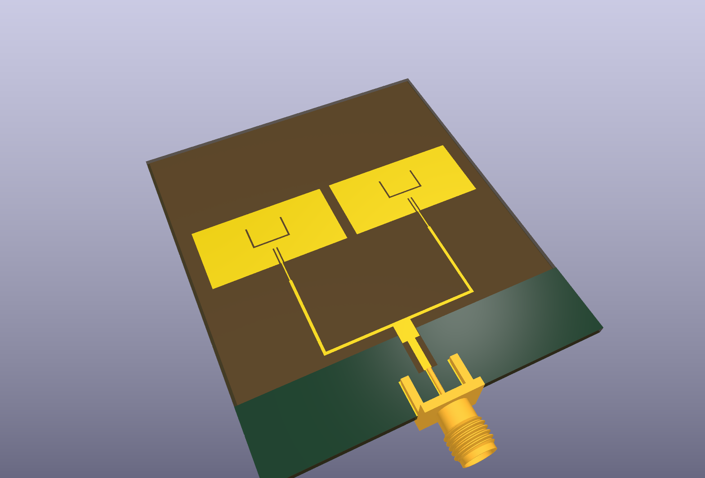
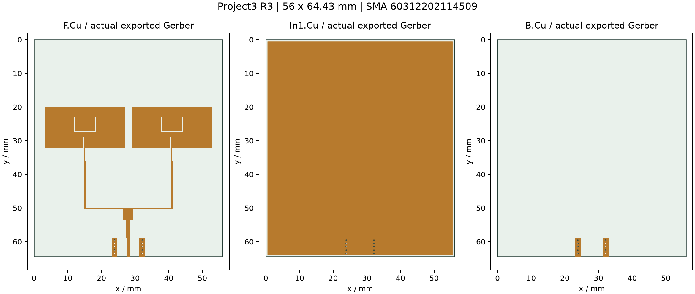
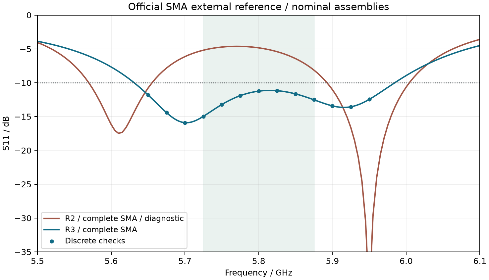

# Project3 R3 制造与仿真交付

状态：**名义首板候选，制造资料齐备，待板厂叠层/工艺回签及首板实测**。指标与限制见 [最新模型核验报告](../../docs/Project3_最新模型核验报告.md)。

板外形 56×64.430 mm，四层 FR4，名义板厚 1.6 mm，关键 L1–L2 介质 0.2104 mm。两段输入匹配自连接器朝天线方向为 1.276×5.266 mm 和 3.000×3.394 mm。J1 为 Würth 60312202114509，端接 SMA 母头。

| 文件/目录 | 用途 |
|---|---|
| `Project3_array_R3.kicad_pro`、`.kicad_pcb`、`.kicad_dru` | KiCad 原生工程与板边规则 |
| `Project3_RF.pretty/`、`Project3_RF.3dshapes/`、`fp-lib-table` | 工程封装与官方 SMA 机械模型 |
| `Gerber/` | 四层铜、两面阻焊/丝印、板框、钻孔及辅助图 |
| [Project3_R3_JLC_Gerber.zip](Project3_R3_JLC_Gerber.zip) | 10 个文件置于根目录的裸板上传包 |
| [FABRICATION_NOTES.md](FABRICATION_NOTES.md)、[PCB_订购说明.md](PCB_订购说明.md) | 加工条件、订购参数及待确认项 |
| `BOM.csv`、`placement.csv`、`stackup.csv`、`.ipc` | 采购、装配、叠层与电测网表 |
| `assembly.step`、`board_mechanical.step`、预览图 | 装配与机械检查 |
| `HFSS_full_SMA/` | 原生 HFSS 工程、模型范围及导出结果；无完整求解缓存 |
| `design_validation.json`、`cam_validation.json`、`drc.json` | 名义设计与制造一致性核验数据 |
| [scripts/REPRODUCE.md](scripts/REPRODUCE.md) | 自包含生成、分析与检查脚本 |

中心 5.8 GHz S11 为 −11.245 dB，连续 −10 dB 带宽约 353.55 MHz；150 MHz 窗口最差 S11 为 −11.138 dB。中心局部次峰抑制约 16.22 dB；5.725 GHz 仅 2.90 dB，不能声称全频带旁瓣合格。中心辐射效率约 6.79%。S11 最低点位于 5.702 GHz，中心频率容差需按课程验收口径确认。

当前文件指定沉银；OSP 工艺尚待确认。`manufacturing_release=false`，尚无板厂回签、加工或实测结果。PCB BOM 每板采购 J1 一个，ANT1 为板上铜形；商城商品编号与采购可用性待核实。

