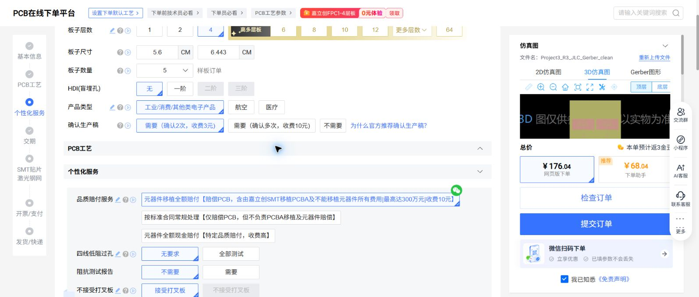
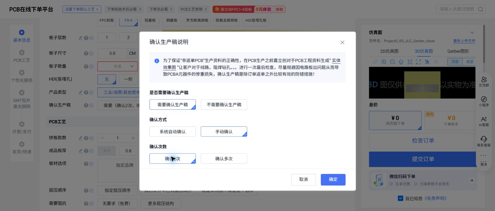
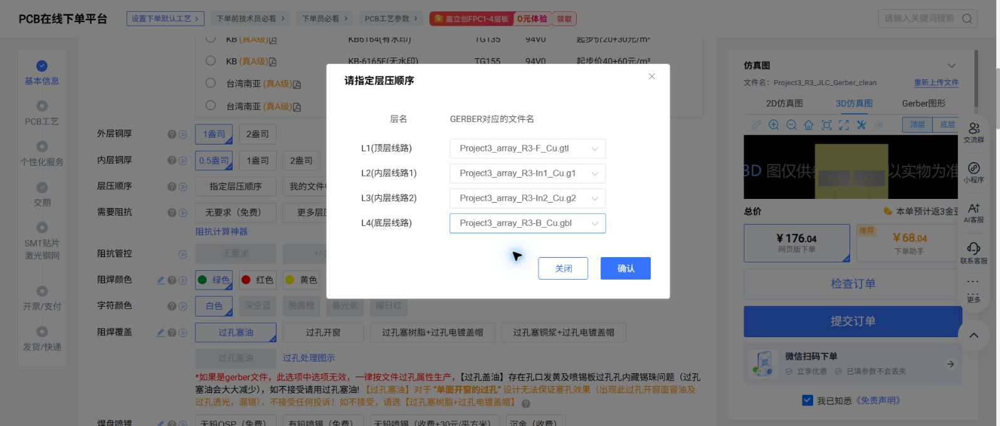
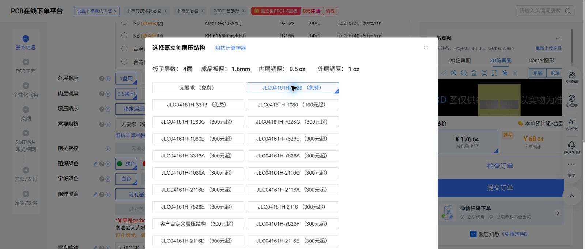
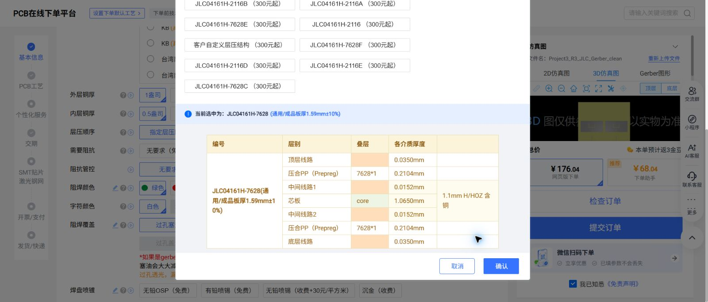
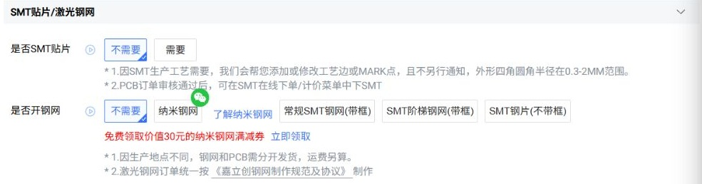
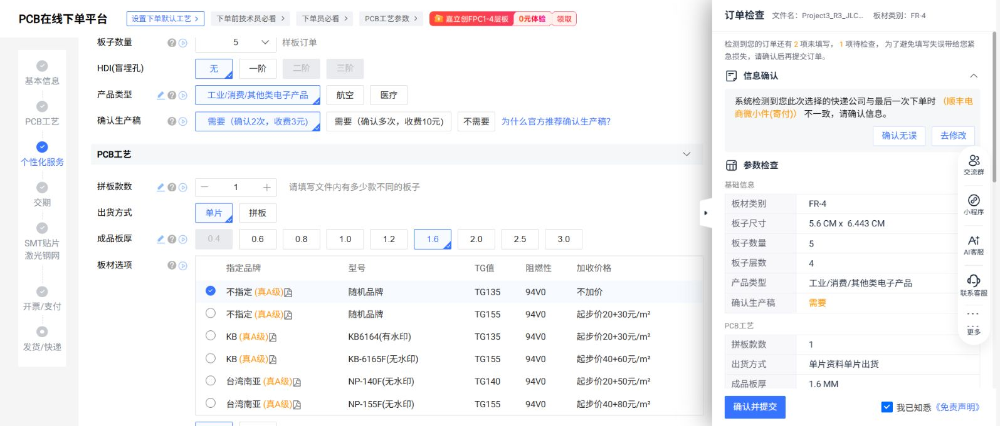
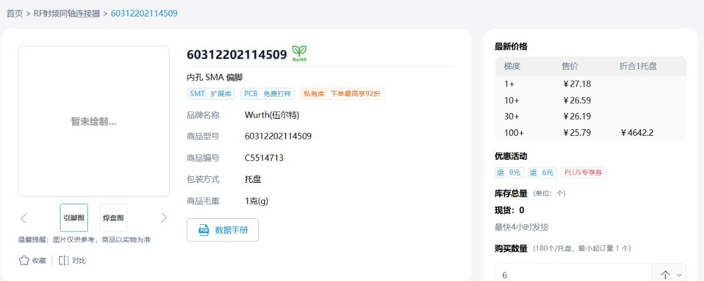
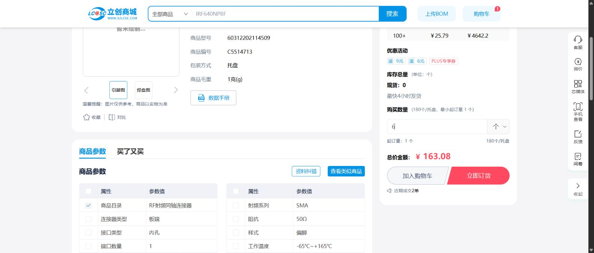

# 从 Gerber 导入到付款前：Project3 PCB 与 SMA 购买清单

适用设计：**R3，5.8 GHz 1×2 贴片阵列，56×64.430 mm，四层 FR4，伍尔特 60312202114509 SMA 接口**。

PCB 在 **嘉立创 PCB 下单平台**订做，SMA 在 **立创商城**购买。这是两笔订单，各自核对运费、交期和收货资料。网页核对日期为 **2026-11-03**；截图采集于 11 月 2 日晚至 3 日凌晨，价格和库存只代表该时点。

本文配图均为实际网页截图。PCB 演示使用账户内已解析的 `Project3_R3_JLC_Gerber_clean` 记录；本地正式上传文件是下方的 `Project3_R3_JLC_Gerber.zip`。本次重新上传受 Chrome 扩展本地文件访问权限限制，不能把演示截图视为这份本地 ZIP 的重新上传成功记录。**两个流程均停在提交前，未创建订单、未付款。**

## 先把购买清单放在手边

| 项目 | 购买内容 | 数量 | 当前页面金额 | 下单前要核对什么 |
|---|---|---:|---:|---|
| PCB | 本目录的 R3 Gerber，四层 FR4、1.6 mm、7628 叠层、无铅 OSP | 5 片 | 网页版试算 ¥186.84，未选快递 | 实际叠层、板厚公差、板边露铜与工艺回签 |
| J1 | Wurth（伍尔特）**60312202114509**，商城编号 **C5514713** | 6 只 | 含税单价 ¥27.18，货款 **¥163.08** | 5 只装板＋1 只备用；现货 0，需订货，确认交期 |
| ANT1 | PCB 上的天线铜形 | 无须另购 | — | 随 PCB 加工，不是贴装元件 |
| 测试线（已有可不买） | 板端配标准 SMA 公头，50 Ω，工作频率至少覆盖 5.8 GHz；仪器端按 VNA 接口匹配 | 按测试需求 | 本文未询价 | 区分标准 SMA 与 RP-SMA，核对校准件和线缆指标 |

两笔页面货款参考合计 **¥349.92**，不是最终含运费总价。PCB 的 ¥186.84 包含页面所选的品质赔付费 ¥10、板内不加标志费 ¥10、确认生产稿费 ¥3 及产品服务税费；品质赔付属于需本人阅读并选择的合约选项。商品运费、优惠、实际工艺审核和价格变动都可能改变最终支付金额。

SMA 直达页：[立创商城 C5514713](https://item.szlcsc.com/6430867.html)。PCB 上传包：[Project3_R3_JLC_Gerber.zip](Project3_R3_JLC_Gerber.zip)。完整工艺条件：[FABRICATION_NOTES.md](FABRICATION_NOTES.md)。

## 第 1 步：进入真正的 Gerber 上传入口

打开 [嘉立创客户中心](https://member.jlc.com/)，登录后从左侧进入 **PCB / FPC 订单 → 计价/下单**，也可直接打开 [选择文件下单页](https://www.jlc.com/newOrder/#/pcb/newOnlinePlaceOrder)。

点击蓝色 **“上传PCB/FPC下单”**，选择本目录的 `Project3_R3_JLC_Gerber.zip`。右侧的“在线计价”只用于无文件预估，不是文件上传入口。若文件已上传并解析，可从历史记录点击“立即下单”进入参数页。

ZIP 应直接包含以下 **10 个文件**，不用把 HFSS、报告、BOM、STEP 或脚本一起上传：

| 文件 | 含义 |
|---|---|
| `Project3_array_R3-F_Cu.gtl` | 顶层 L1 铜 |
| `Project3_array_R3-In1_Cu.g1` | 内层 L2 铜，RF 参考地 |
| `Project3_array_R3-In2_Cu.g2` | 内层 L3 铜，接地过孔焊环 |
| `Project3_array_R3-B_Cu.gbl` | 底层 L4 铜 |
| `Project3_array_R3-F_Mask.gts`、`-B_Mask.gbs` | 两面阻焊 |
| `Project3_array_R3-F_Silkscreen.gto`、`-B_Silkscreen.gbo` | 两面丝印 |
| `Project3_array_R3-Edge_Cuts.gm1` | 成品板框 |
| `Project3_array_R3.drl` | 贯通电镀孔钻孔文件 |

使用 ChatGPT Chrome 扩展上传时，如果提示本地文件权限不足，需要由本人在 `chrome://extensions` → ChatGPT 扩展 →“详情”中开启 **“允许访问文件网址”**，再回到本页选择 ZIP。[扩展文件上传说明](https://developers.openai.com/codex/app/chrome-extension#upload-files)。普通手动选择文件不依赖代理的上传接口。

## 第 2 步：解析后先核对尺寸、数量和板材

选择 **FR-4、4 层、5 片、无 HDI**，产品类型选择“工业/消费/其他类电子产品”。尺寸栏单位是 **cm**，本设计填 **5.6 × 6.443 cm**。

网页对已有记录自动带出的长边为 6.44 cm，只保留了两位小数；板框的设计尺寸为 64.430 mm，生产外形以 Gerber 为准，订购参数与备注也写清 56×64.430 mm。检查预览中的两个贴片、馈电网络、板边 SMA 安装区和钻孔位置，不把网站的“仿真图”当作电磁性能仿真。

“确认生产稿”选择 **需要 → 手动确认 → 确认 2 次**。网页此选项标价 ¥3；它让你在板厂工程处理后检查资料，不代表板厂已接受所有特殊工艺。

## 第 3 步：设置单片、板厚、铜厚和四层文件顺序

| 页面项目 | 本项目设置 |
|---|---|
| 拼板款数 | 1 款 |
| 出货方式 | **单片**；不是 5 款、不是 5 联拼板 |
| 成品板厚 | **1.6 mm** |
| 外层铜厚 | **1 盎司**，对应设计表 35 µm |
| 内层铜厚 | **0.5 盎司**，对应所选叠层表 15.2 µm |
| 层压顺序 | **指定层压顺序** |

在层压顺序弹窗中，按下面顺序逐项选择。不要仅凭扩展名排序，也不要把阻焊文件选作铜层。

| 页面层别 | 选择的文件 |
|---|---|
| L1（顶层线路） | `Project3_array_R3-F_Cu.gtl` |
| L2（内层线路1） | `Project3_array_R3-In1_Cu.g1` |
| L3（内层线路2） | `Project3_array_R3-In2_Cu.g2` |
| L4（底层线路） | `Project3_array_R3-B_Cu.gbl` |

## 第 4 步：在“更多层压结构”里选择 7628

点击“需要阻抗”旁的 **更多层压结构**，选择 **JLC04161H-7628**。选定后页面按钮显示 `JLC04161H-7628（免费）`。此处借用的是网页的叠层选择入口。

向下查看叠层表，重点核对顶层到 L2 的压合介质为 **0.2104 mm**，芯板为 **1.0650 mm**。这两个数决定实际结构能否与当前 HFSS 名义模型对应。

**叠层指定后，另一个“阻抗管控”选“无要求”**，并在技术备注要求保持实际 RF 铜形和线宽。阵列中含多种宽度的匹配段，不能让板厂把所有线段统一改成 50 Ω 线宽。

网页将该叠层标为 **成品板厚 1.59 mm±10%**；这不等于满足连接器卡板处的 **1.60±0.05 mm** 目标。表内厚度合计约 1.5862 mm。投产前应由板厂确认实际材料 Dk/Df、关键 PP1 成品厚度、成品铜厚、总厚及卡板处公差，不能通过改变 0.2104 mm 的关键 RF 介质来补足总厚。

## 第 5 步：选无铅 OSP，保留实际开窗和钻孔

焊盘喷镀选择 **无铅 OSP**；阻焊绿色、字符白色。天线与馈线的开窗严格按 Gerber，不能为了保护铜面额外覆盖绿油。

“最小孔径/外径”选择页面的 **0.3 mm 免费档**。其中括号里的外径 0.4/0.45 是工艺档位说明，本设计实际过孔焊环仍按文件的 **0.60 mm 外径、0.30 mm 成品孔径**制作，不据此缩小焊环。页面也明确提示：Gerber 订单的过孔阻焊属性按文件生产；不要把“过孔塞油”等按钮理解成可以覆盖文件开窗设计。

金手指斜边、金属包边、半孔、背钻均不需要；线路测试采用页面的 AOI 全测＋飞针全测。

OSP 是本清单的首板采购工艺。当前 HFSS 以铜导体建模，没有单独的 OSP 膜层或表面镀银层认证，因此仍需首板 VNA 和方向图实测；不能将表面处理选择等同于实测性能保证。

## 第 6 步：不加板内标志，并填写技术备注

“板上加标志”选择 **不加任何标志**，页面收费 ¥10。天线空白区域也参与电磁环境，不放二维码、工艺字、测试焊盘或额外铜平衡。

下面这段可以直接复制到 **PCB订单备注**，不需要写进 Gerber ZIP：

> 4层射频天线，56×64.430mm，单片5片，表面处理无铅OSP。层序F_Cu.gtl→In1_Cu.g1→In2_Cu.g2→B_Cu.gbl。JLC04161H-7628，关键L1-L2压合介质0.2104mm；请确认实际材料Dk/Df、成品铜厚及压合公差。SMA卡板处目标1.60±0.05mm，不能满足请联系，不改变关键PP厚度凑总厚。保持RF铜形、线宽和阶跃位置，不进行阻抗调线宽；L2参考地，L3仅过孔焊环，不加整面铜/铜平衡。阻焊开窗按Gerber，不额外覆盖天线/馈线。J1五个端接焊盘到输入板边，需允许铣边露铜；无需金属包边、半孔、金手指或倒角。10个0.30mm贯通电镀孔按文件。不加板内工艺字、二维码、标志或测试焊盘。工艺回签并经客户手动确认生产稿后投产。

品质赔付服务是额外的合约选择。截图保留了页面的 ¥10 选项，本文未替你接受其他合约；请本人阅读赔付范围后决定，不把它当作天线加工必选工艺。

## 第 7 步：不选 SMT、不选钢网，订单手动确认

本板只需手工装配一个端接 SMA。选择 **SMT贴片不需要、钢网不需要**；页面若弹出 SMT 计价广告，确认“确定，不需要SMT”。

在开票/支付区域选择 **手动确认订单**。注意这是“订单价格与支付确认”，与前面的“手动确认生产稿”是两个不同设置，都要核对。

发票、联系人、收货地址与快递使用本人实际资料。页面若提示缺乡镇/街道、发货方式未填或快递与上单不一致，应逐项处理，不能直接点“确认无误”。网页报价与旁边的“下单助手”报价属于不同入口，不能把助手优惠价当作网页版已确定成交价。

点击 **检查订单**，逐项核对 FR-4、尺寸、5 片、4 层、单片、1.6 mm、铜厚、7628、OSP、无 SMT/钢网、手动确认。检查面板中的 **“确认并提交”会进入正式提交步骤**；本教程在此停止。

提交审核后的板厂工艺回复和生产稿检查属于后续实际下单环节，本文没有该环节的完成截图。收到生产稿后，核对两贴片/U槽、匹配阶跃、L2退边、L3焊环、天线开窗和J1端接露铜，确认板厂接受技术条件后再安排生产。当前项目 `manufacturing_release=false`。

## 第 8 步：在立创商城买对应的原型号 SMA

打开 [C5514713 商品详情](https://item.szlcsc.com/6430867.html)，核对这三个身份字段：

| 字段 | 应看到的内容 |
|---|---|
| 品牌 | **Wurth（伍尔特）** |
| 完整制造商型号 | **60312202114509** |
| 立创商品编号 | **C5514713** |

商品参数为 SMA、50 Ω、内孔母座，页面频率标注 18 GHz。机械安装按 [厂家尺寸图](connector_datasheet.pdf) 和当前 R3 封装核对。不要仅搜索“SMA”就选择外观相近的通用件，也不要买成 RP-SMA 或不同板厚的卡边型号。

购买数量填 **6，单位“个”**：5 块板各 1 个，余 1 个备用。页面写“180个/托盘”是包装量，最小起订量是 1 个，不需要买一整盘。6 个使用 1+ 档含税单价 ¥27.18，页面合计 **¥163.08**。

现货为 **0**，使用的是 **立即订货**入口。点入后到达“填写核对订单信息”页面，商品行应显示：商城自营、完整型号、C5514713、数量 6、含税单价 ¥27.18、金额 ¥163.08、交货方式 **订货**。

在该页由本人补齐收货人、下单联系人、发票和快递；确认订货价格、实际可供数量与交期，再阅读用户协议并决定提交、付款。未选地址/快递时显示的运费 ¥0 不代表本单已经包邮。页面“最快4小时发货”也不能作为零库存订货的交期承诺。

若交期不合适，先与商城确认原型号供货渠道；不要直接把便宜的国产卡边 SMA 装进当前 R3 焊盘。更换型号需要单独核对封装和输入过渡，并重新验证匹配。

## 提交前对照这份短清单

- [ ] 上传的是 R3 的 10 文件 Gerber ZIP，解析预览与本地板框、铜层和钻孔对应。
- [ ] PCB 为 4 层、5 片、单片、56×64.430 mm、1.6 mm，铜厚和 7628 叠层对应设计。
- [ ] 表面处理、备注和加工说明统一为无铅 OSP；RF 铜形、开窗和线宽保持设计值。
- [ ] 板厂已确认关键 PP1、实际材料、成品铜厚、卡板处厚度和 J1 板边露铜。
- [ ] 不加板内标志；无 SMT、无钢网；生产稿和订单均手动确认。
- [ ] SMA 为 C5514713 / 60312202114509，6 个；订货交期、运费与含税金额可接受。
- [ ] 本人收货、联系人、发票和快递无误；已阅读实际订单协议，再决定提交与付款。

相关资料：[PCB 下单入口](https://www.jlc.com/newOrder/#/pcb/newOnlinePlaceOrder)、[SMA 商品页](https://item.szlcsc.com/6430867.html)、[立创购物流程](https://www.szlcsc.com/help/102.html)、[立创订货服务](https://www.szlcsc.com/help/401.html)、[当前模型核验报告](../../docs/Project3_最新模型核验报告.md)。
